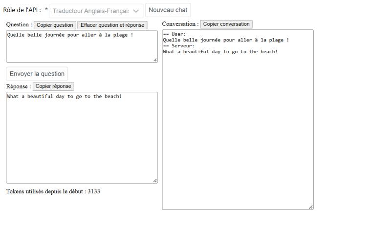
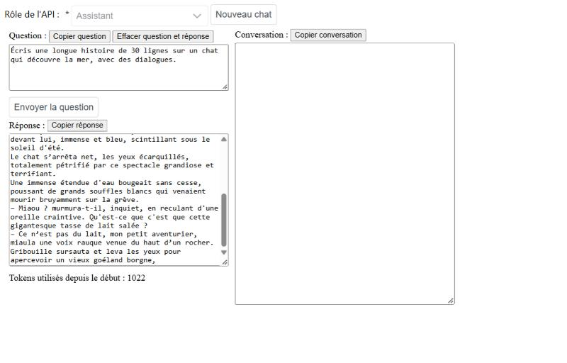
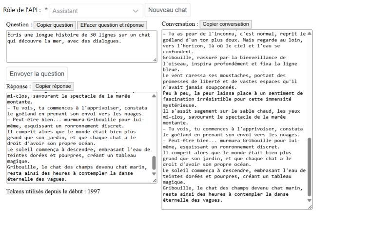
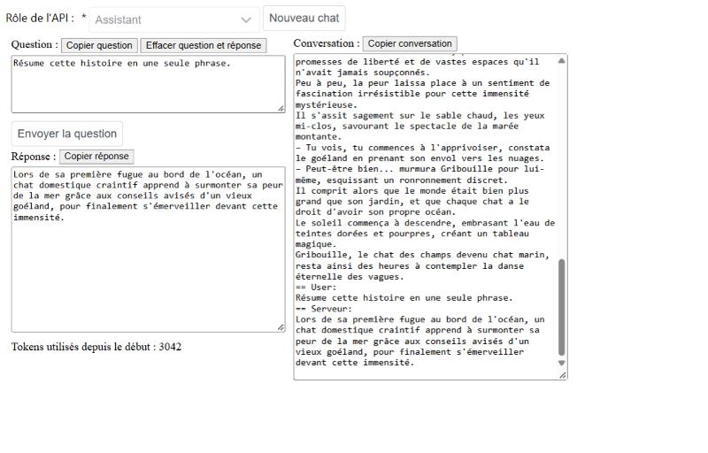
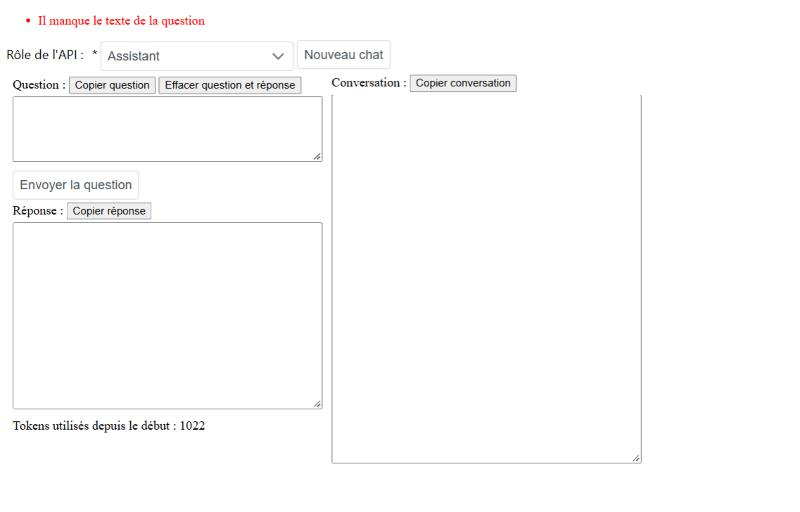

# TP 2 - Application Web de chat avec LangChain4j et Gemini (Aya Tijini)

Application Web (Jakarta EE 11, JSF et PrimeFaces) qui reprend l'interface du TP 0 : l'utilisateur choisit un rôle
« système », pose des questions à un LLM (**Gemini**) et la conversation s'affiche à droite de la page.
Contrairement au TP 1, l'API du LLM n'est plus appelée avec des documents JSON écrits à la main :
l'application utilise **LangChain4j**, qui s'occupe des requêtes, de l'historique de la conversation et du format
propre à chaque LLM.

Les tests qui ont préparé ce TP sont dans un autre dépôt : `tp2TestsAyaTijini`.

## Aperçu du rendu

L'application tourne sur un serveur local (`localhost`), qui n'est pas accessible depuis un autre ordinateur.
Voici donc des captures d'écran de l'application en fonctionnement.

**Rôle « Traducteur Anglais-Français »** : le LLM traduit la phrase au lieu d'y répondre, donc le rôle système est
bien pris en compte. La question et la réponse sont ajoutées à la conversation (à droite).

**Streaming** : une longue réponse en cours de génération. Elle s'affiche au fur et à mesure dans la zone « Réponse »
(reçue par le websocket) ; la conversation et le nombre de tokens ne sont pas encore mis à jour.

**Fin de la réponse** : la conversation est mise à jour et le nombre de tokens utilisés depuis le début de la session
est augmenté (de 1022 à 1997 tokens).

**Mémoire de la conversation** : la deuxième question (« Résume cette histoire en une seule phrase. ») n'a de sens
que grâce à l'historique, renvoyé au LLM par LangChain4j. Le total des tokens a encore augmenté (3042).

**Envoi d'une question vide** : le message d'erreur s'affiche en rouge en haut de la page (par l'appel Ajax).

## Versions utilisées

| Élément | Version |
|---|---|
| Java (JDK Temurin) | 25 |
| Jakarta EE (Web Profile) | 11 |
| Serveur d'application | Payara 7.2026.10 |
| PrimeFaces | 16.0.1 |
| LangChain4j | 1.22.0 (`langchain4j-google-genai` 1.22.0-beta32) |
| Modèle Gemini | `gemini-3.5-flash-lite` |

## Lancer l'application

1. Créer une clé pour l'API de Gemini (Google AI Studio) et la mettre dans la variable d'environnement
   **`GEMINI_KEY`** (la clé n'est jamais écrite dans le code ; elle est lue dans le constructeur de `LlmClient`).
   Redémarrer Payara ou l'IDE pour que la variable soit prise en compte.
2. Construire le WAR : `mvn clean package` (génère `target/tp2WebAyaTijini-1.0-SNAPSHOT.war`).
3. Déployer le WAR sur Payara (par exemple avec IntelliJ IDEA, ou avec
   `asadmin deploy target/tp2WebAyaTijini-1.0-SNAPSHOT.war`).
4. Ouvrir http://localhost:8080/tp2WebAyaTijini-1.0-SNAPSHOT/ (la page `index.xhtml` est la page d'accueil).

Sous Windows, si Java refuse le certificat de l'API de Gemini (« PKIX path building failed »), ajouter l'option JVM
`-Djavax.net.ssl.trustStoreType=WINDOWS-ROOT` au serveur d'application.

## Organisation du code

| Fichier | Rôle |
|---|---|
| `src/main/webapp/index.xhtml` | Page JSF : rôle système, question, réponse et conversation |
| `src/main/webapp/resources/` | Fichiers CSS et JavaScript utilisés par la page (`script.js` : copie dans le presse-papier, et fonctions du streaming) |
| `src/main/webapp/WEB-INF/web.xml` | Page d'accueil `index.xhtml` et activation du point d'accès websocket de JSF |
| `.../tp2/jsf/Bb.java` | Backing bean (`@ViewScoped`) : état de la page ; il délègue le travail avec le LLM à `LlmClient` et envoie les réponses partielles dans le websocket |
| `.../tp2/llm/LlmClient.java` | Classe « métier » (`@Dependent`) : crée le modèle Gemini (streaming), l'assistant (`AiServices`) et la mémoire de la conversation |
| `.../tp2/llm/Assistant.java` | Interface du service IA (la méthode retourne un `TokenStream`) ; LangChain4j en fournit l'implémentation |
| `.../tp2/llm/CompteurTokens.java` | Bean de portée session qui accumule le nombre de tokens utilisés depuis le début de la session |

Enchaînement : `Bb.envoyer()` → `LlmClient.envoyerRequete(question)` → `Assistant.chat(question)` (proxy créé par
LangChain4j) → API de Gemini. Les réponses reviennent ensuite par le websocket jusqu'à la page (voir plus bas).

## Parties optionnelles du TP

### Nombre de tokens utilisés depuis le début

Le total est affiché sous la zone de la réponse. Il n'est pas gardé dans le backing bean (de portée view) car il serait
perdu au changement de rôle (« Nouveau chat ») : il est accumulé dans `CompteurTokens`, un bean de portée **session**
injecté à la fois dans `LlmClient` (qui y ajoute les tokens de chaque requête) et dans `Bb` (qui affiche le total).
Les tokens sont lus dans la réponse du LLM (`ChatResponse.tokenUsage()`).

### Streaming de la réponse avec un websocket

La réponse du LLM s'affiche au fur et à mesure de sa génération (Gemini regroupe les tokens : on reçoit quelques
groupes de tokens et pas des tokens isolés).

- La page contient `<f:websocket channel="chat" scope="view" onmessage="socketListener"/>` et la question est
  envoyée par un appel Ajax (`<f:ajax>`), pour que la page ne soit pas remplacée.
- `Bb.envoyer()` configure le `TokenStream` : `onPartialResponse` envoie chaque morceau dans le websocket,
  `onCompleteResponse` met à jour la conversation et envoie un dernier message (conversation et total de tokens).
- La fonction JavaScript `socketListener` (dans `script.js`) ajoute les morceaux à la zone de la réponse.
- Les réponses du LLM sont reçues dans un autre thread que celui de la requête HTTP, où le contexte CDI de la session
  n'est pas actif : `LlmClient` récupère l'accumulateur de tokens dans le thread de la requête, pour l'utiliser
  ensuite quand la réponse est terminée.
- La mémoire de la conversation n'est pas mise à jour à la main : LangChain4j y ajoute la question et la réponse
  tout seul quand la réponse est terminée.

À cause du websocket, il faut **redémarrer Payara** (et pas seulement redéployer l'application). Si le navigateur
affiche une erreur JavaScript (« socketListener is not defined »), vider son cache : il a gardé une ancienne version
de `script.js`.

## L'historique de la conversation

L'API des LLM est sans état : c'est le client qui doit renvoyer l'historique à chaque requête. Avec LangChain4j,
c'est la mémoire (`ChatMemory`, qui garde les 20 derniers messages) qui s'en charge. Le rôle système choisi par
l'utilisateur est ajouté à cette mémoire sous la forme d'un `SystemMessage` au début de la conversation
(la mémoire est vidée avant, car le contexte change complètement). « Nouveau chat » crée un nouveau backing bean,
donc une nouvelle mémoire.
